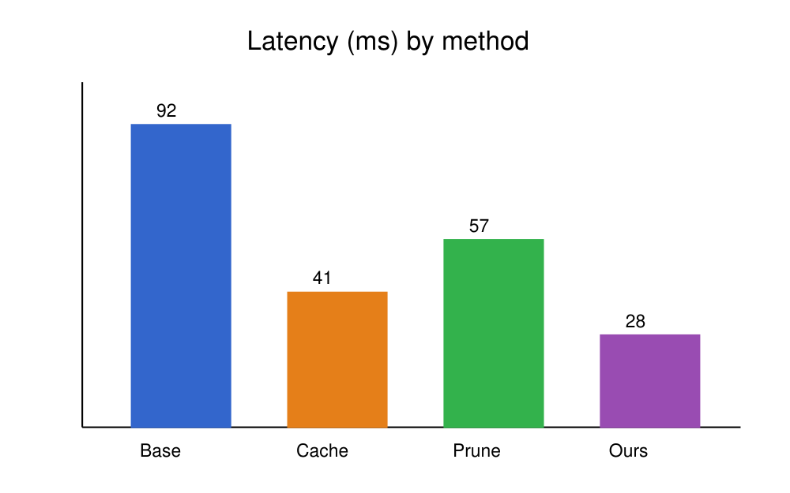

# Introduction {#sec:intro}

Mobile and embedded devices increasingly run neural networks locally [@lane2015early]. Many inputs seen by
such devices are **near-duplicates**: consecutive camera frames, repeated voice commands, or similar sensor
readings. Recomputing the full network for each input wastes *time and energy*.

Our contributions are:

1. a similarity key based on early activations,
2. a bounded cache with an admission policy, and
3. an evaluation on illustrative workloads.

# Related Work

Result caching for inference has been explored in serving systems [@crankshaw2017clipper]. Compression and
pruning reduce cost per inference [@han2016deep] and are complementary to caching.

# Method

Given an input $x$, we compute the first $k$ layers to obtain activation $a_k(x)$ and its hash

$$
h(x) = \operatorname{sign}(W a_k(x)), \quad W \in \mathbb{R}^{b \times d}
$$ {#eq:hash}

If a cached entry with Hamming distance below $\tau$ exists, its output is returned (see @eq:hash).

## Admission Policy

Entries are admitted when their predicted reuse probability exceeds a threshold that adapts to the memory
budget, so memory use stays at or below 50% of the budget.

# Evaluation

Figure @fig:latency compares latency and Table @tbl:results summarizes accuracy.

{#fig:latency}

| Method   | Top-1 (%) | Latency (ms) |
|----------|-----------|--------------|
| Baseline | 76.1      | 92           |
| Pruning  | 74.9      | 57           |
| EdgeCache| 75.8      | 28           |

Table: Accuracy and latency (illustrative values). {#tbl:results}

{#fig:hitrate}

# Conclusion

EdgeCache shows that simple result caching can cut on-device latency for near-duplicate inputs.

# Acknowledgments

This sample was written to test Paper Forge.
